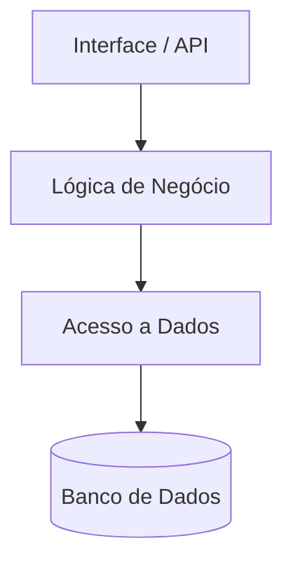
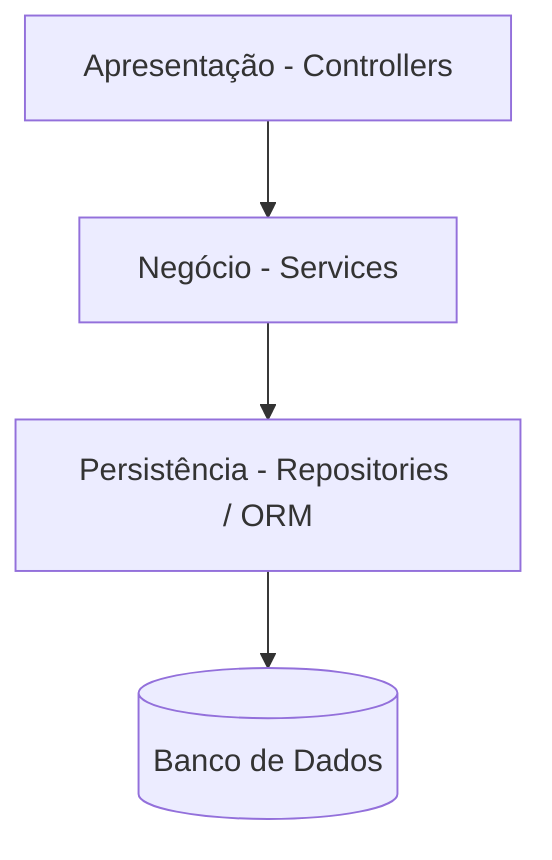
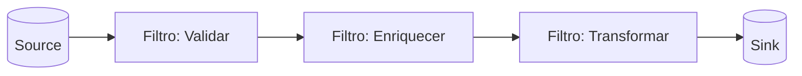
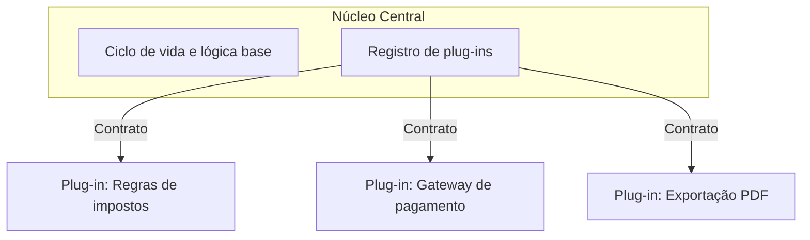

# 🏢 Estilos Arquiteturais Monolíticos

> **Módulo 01 · Fundamentos** — Estilos em que o sistema é implantado como uma única unidade: monólito tradicional, monólito modular, camadas, pipes and filters e microkernel.

---

## 1. Sistemas monolíticos

### Conceito

Na **arquitetura monolítica**, todos os módulos (interface, lógica de negócio e acesso a dados) ficam em **um único código-fonte** e são implantados como **um único artefato executável** (um `.jar`, um processo Node, uma imagem Docker).



> ⚠️ "Monolito" não é sinônimo de "código ruim". Um monólito bem modularizado é a escolha certa para muitos produtos, principalmente no início. O problema é o **monólito desorganizado** (*big ball of mud*).

### Vantagens

- **Desenvolvimento e testes simples:** roda localmente com um comando; debug centralizado.
- **Deploy inicial descomplicado:** um único pacote vai para produção.
- **Baixa latência interna:** chamadas entre módulos são em memória, sem rede.
- **Transações ACID locais:** um único banco garante consistência forte facilmente.
- **Custo operacional baixo:** menos infraestrutura e observabilidade para manter.

### Desvantagens

- **Escalabilidade ineficiente:** para aguentar carga em um módulo, é preciso replicar a aplicação inteira.
- **Alto acoplamento:** mudar uma funcionalidade pode ter efeitos colaterais em partes não relacionadas.
- **Deploys arriscados:** qualquer mudança exige redeploy e reinício do sistema inteiro.
- **Tecnologia única:** difícil adotar outra linguagem ou banco para uma parte específica.
- **Escala de times:** muitos desenvolvedores no mesmo código geram conflitos e lentidão.

### Monólito modular

Meio-termo muito usado hoje: um único deploy, mas internamente dividido em **módulos de negócio isolados** (ex.: `pedidos`, `pagamentos`, `catalogo`), cada um com sua API interna e, de preferência, seu próprio esquema no banco.

```text
app/
├── modules/
│   ├── pedidos/      (domain, application, infra) → expõe PedidosFacade
│   ├── pagamentos/   (domain, application, infra) → expõe PagamentosFacade
│   └── catalogo/
└── shared/
```

Benefícios: mantém a simplicidade operacional do monólito e facilita uma futura extração para microsserviços (cada módulo já tem fronteira clara). Exemplo conhecido: Shopify.

---

## 2. Arquitetura em camadas (Layered Architecture)

### Conceito

Divide o sistema em **níveis horizontais de responsabilidade** (*separation of concerns*). Cada camada tem um papel e consome apenas a camada imediatamente abaixo.



| Camada | Responsabilidade | Exemplos |
|---|---|---|
| **Apresentação** | Interagir com o usuário ou expor rotas HTTP | Controllers, views |
| **Negócio (Service)** | Validações, regras de negócio, fluxos | Services, use cases |
| **Persistência** | Ler e gravar dados | Repositories, ORMs (Prisma, Mongoose) |
| **Banco de dados** | Armazenamento | PostgreSQL, MongoDB |

### Camadas fechadas × abertas

- **Fechada:** a requisição **deve** passar pela camada (não pode pular). Garante isolamento.
- **Aberta:** pode ser pulada (ex.: uma camada de serviços utilitários compartilhados).

### Exemplo (Express — como no projeto final do módulo)

```js
// routes → controller → service → model
router.get('/products/:id', productController.getById);

// controller: só HTTP
async getById(req, res) {
  const product = await productService.findById(req.params.id);
  if (!product) return res.status(404).json({ message: 'Não encontrado' });
  res.json(product);
}

// service: regra de negócio
async findById(id) { return productModel.findById(id); }
```

### Vantagens

- Isolamento de responsabilidades e manutenção facilitada;
- Reutilização da camada de negócio por vários clientes (web, mobile, integrações);
- Times podem trabalhar em camadas diferentes em paralelo;
- Estilo amplamente conhecido — bom ponto de partida.

### Desvantagens

- **Antipadrão sinkhole (sumidouro):** requisições atravessam todas as camadas sem lógica nenhuma (CRUD puro). Regra prática **80/20**: se mais de ~20% das requisições forem sinkhole, avalie abrir camadas ou outro estilo.
- **Overhead:** conversão de modelos (DTO ↔ entidade) entre camadas.
- **Deploy acoplado:** continua sendo um único artefato.
- **Mudanças atravessam todas as camadas:** uma feature nova costuma tocar controller, service e repository.

---

## 3. Pipes and Filters

### Conceito

Estilo para **processamento sequencial de fluxos de dados**. O sistema é dividido em componentes independentes (**filtros**) ligados por canais unidirecionais (**pipes**). O dado é transformado aos poucos, como numa linha de montagem.



| Componente | Papel |
|---|---|
| **Filter** | Unidade autônoma: recebe dados, faz **uma** transformação (validar, limpar, enriquecer) e repassa. Sem estado global. |
| **Pipe** | Canal que leva os dados de um filtro a outro, isolando-os. |
| **Source** | Origem dos dados (arquivo, sensor IoT, fila). |
| **Sink** | Destino final (banco, data warehouse, API). |

Tipos de filtro: **produtor** (source), **transformador**, **testador** (descarta ou deixa passar) e **consumidor** (sink).

### Exemplos reais

- Pipes do shell Unix: `cat log.txt | grep ERROR | sort | uniq -c`
- Pipelines de ETL / dados (Apache Beam, Spark), compiladores (léxico → sintático → semântico → código);
- Streams em Node.js:

```js
fs.createReadStream('vendas.csv')
  .pipe(csvParser())        // filtro: parse
  .pipe(validarLinha())     // filtro: valida
  .pipe(converterMoeda())   // filtro: transforma
  .pipe(salvarNoBanco());   // sink
```

### Vantagens e desvantagens

| Vantagens | Desvantagens |
|---|---|
| Filtros reutilizáveis e recombináveis | Overhead de parsing/serialização entre filtros |
| Fácil testar cada filtro isolado | Tratamento de erro difícil (falha no meio da cadeia) |
| Permite paralelismo/concorrência | Não serve para sistemas interativos |

---

## 4. Microkernel (Arquitetura de plug-ins)

### Conceito

Divide o sistema em um **núcleo central (core)** enxuto e **plug-ins** independentes. O núcleo mantém a aplicação rodando e expõe contratos para que funcionalidades extras sejam acopladas.



| Componente | Responsabilidade |
|---|---|
| **Núcleo (core)** | Inicialização, funcionalidade mínima, ciclo de vida e registro dos plug-ins. Sem regras específicas. |
| **Plug-ins** | Adicionam funcionalidades, telas, algoritmos ou integrações, usando os contratos do núcleo. |
| **Contratos / Registry** | Padronizam a comunicação núcleo ↔ plug-in e sabem quais plug-ins existem. |

### Exemplo simplificado

```ts
interface CalculadoraFrete { regiao: string; calcular(peso: number): number; }

class Registry {
  private plugins = new Map<string, CalculadoraFrete>();
  registrar(p: CalculadoraFrete) { this.plugins.set(p.regiao, p); }
  obter(regiao: string) { return this.plugins.get(regiao); }
}

registry.registrar({ regiao: 'SUL', calcular: (p) => p * 1.2 });
registry.registrar({ regiao: 'NORTE', calcular: (p) => p * 2.0 });
```

### Vantagens e desvantagens

| Vantagens | Desvantagens |
|---|---|
| Alta extensibilidade sem tocar no núcleo (OCP) | Design do contrato exige muito cuidado |
| Falhas isoladas nos plug-ins | Versionamento: mudar o núcleo pode quebrar plug-ins |
| Times evoluem plug-ins em paralelo | Núcleo pode virar gargalo de escalabilidade |

**Exemplos reais:** VS Code, Eclipse, IntelliJ, navegadores (extensões), WordPress, sistemas de seguros/impostos com regras por região.

---

## ✅ Pontos-chave

- Monólito = **um único deploy**. Simples e barato; difícil de escalar times e partes isoladas.
- **Monólito modular** é um ótimo ponto de partida.
- **Camadas:** separação horizontal; cuidado com o *sinkhole*.
- **Pipes and filters:** processamento em sequência de dados.
- **Microkernel:** núcleo mínimo + plug-ins, ideal para produtos customizáveis.

## ❓ Perguntas de revisão

<details><summary>1. O que é o antipadrão sinkhole?</summary>
Quando as requisições passam por todas as camadas sem que nenhuma aplique lógica, só repassando dados. Se for muito frequente (>20%), a arquitetura em camadas pode não ser a melhor opção.
</details>

<details><summary>2. Qual a diferença entre camada fechada e aberta?</summary>
Camada fechada não pode ser pulada pela requisição; camada aberta pode. Camadas fechadas garantem isolamento de mudanças.
</details>

<details><summary>3. Em que tipo de problema Pipes and Filters se encaixa bem?</summary>
Processamento sequencial de fluxos de dados: ETL, compiladores, processamento de logs, streams.
</details>

<details><summary>4. Cite um sistema real que usa microkernel.</summary>
VS Code (extensões), navegadores web, Eclipse, WordPress.
</details>

<details><summary>5. Por que começar com um monólito modular pode ser melhor que microsserviços?</summary>
Mantém o custo operacional baixo e transações locais enquanto o domínio ainda está sendo entendido, e já cria fronteiras claras que facilitam extrair serviços no futuro.
</details>

## 🔗 Relacionadas

- [06 Estilos arquiteturais distribuídos](06%20Estilos%20arquiteturais%20distribuidos.md)
- [Arquiteturas em camadas (Hexagonal, Clean)](../03%20Design%20patterns,%20estilos%20e%20padroes%20arquiteturais/07%20Arquiteturas%20em%20camadas.md)

## 📚 Referências

- RICHARDS, M.; FORD, N. *Fundamentals of Software Architecture*. O'Reilly, 2020 — caps. 10 a 12.
- RICHARDS, M. *Software Architecture Patterns*. O'Reilly, 2015.
