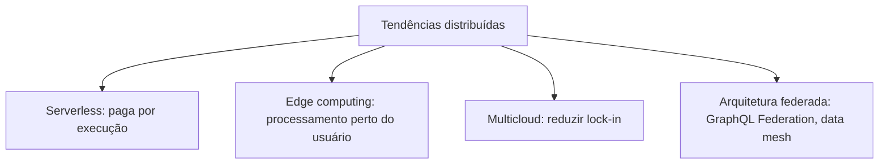
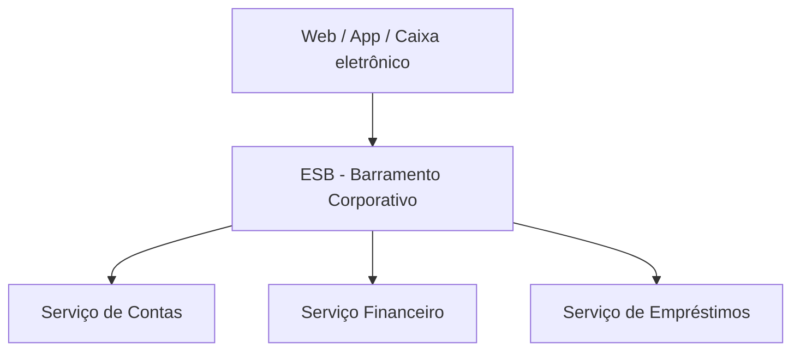
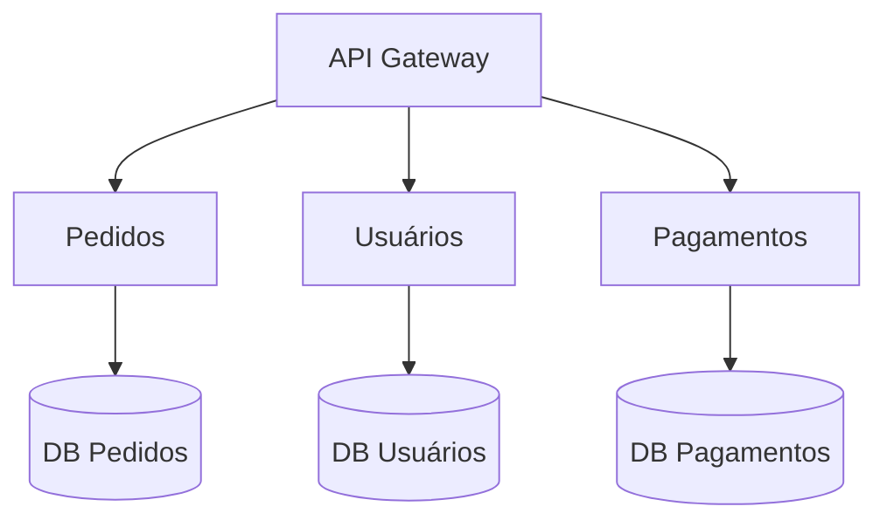
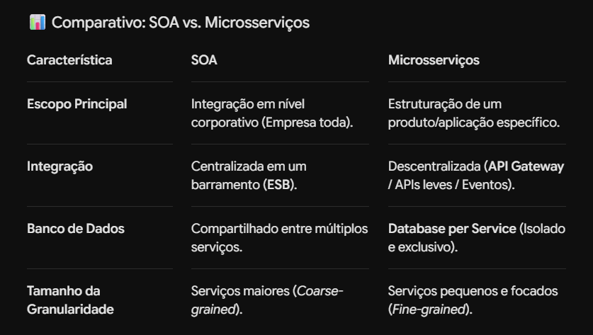
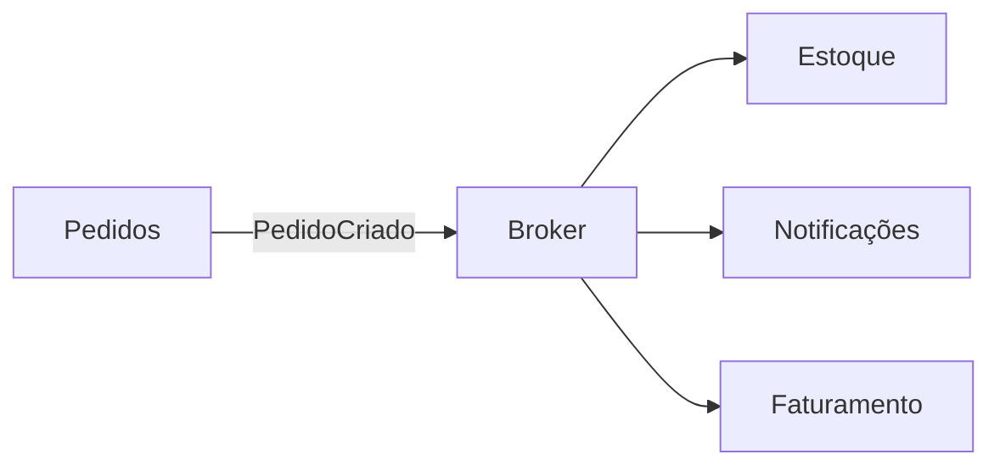

# 🌐 Estilos Arquiteturais Distribuídos

> **Módulo 01 · Fundamentos** — Arquiteturas cujos componentes rodam em processos/servidores separados e se comunicam pela rede: SOA, microsserviços e orientada a eventos.

---

## 1. Conceitos gerais

A **arquitetura distribuída** divide a aplicação em componentes independentes, executados em processos, containers ou servidores distintos, conectados via rede. Diferente do monólito, permite **deploys incrementais e descentralizados**.

### As 6 características fundamentais

| Característica | Descrição |
|---|---|
| **Distribuição** | Serviços executados em nós fisicamente separados |
| **Descentralização** | Execução e dados divididos entre serviços, sem ponto único de controle |
| **Comunicação por rede** | HTTP/REST, gRPC ou mensageria (Kafka, RabbitMQ) |
| **Tolerância a falhas** | A queda de uma parte não derruba tudo |
| **Escalabilidade horizontal** | Mais capacidade adicionando instâncias (*scale-out*) |
| **Heterogeneidade** | Linguagens e bancos diferentes por serviço (*polyglot*) |

### As 8 falácias da computação distribuída (Peter Deutsch / Sun)

Suposições **falsas** que desenvolvedores costumam fazer:

1. A rede é confiável;
2. A latência é zero;
3. A largura de banda é infinita;
4. A rede é segura;
5. A topologia não muda;
6. Existe apenas um administrador;
7. O custo de transporte é zero;
8. A rede é homogênea.

> Toda arquitetura distribuída precisa ser desenhada assumindo que **a rede vai falhar**: timeouts, retries, circuit breakers, idempotência.

### Desafios

- **Complexidade operacional:** exige observabilidade (logs centralizados, métricas e *distributed tracing*);
- **Latência de rede:** chamadas remotas são ordens de grandeza mais lentas que chamadas em memória;
- **Consistência de dados:** vários bancos → consistência eventual, padrão Saga;
- **Testes e debug:** reproduzir problemas que envolvem vários serviços é difícil.

### Tendências

---

## 2. SOA — Arquitetura Orientada a Serviços

### Conceito

Estilo **corporativo** focado em integrar sistemas da organização por meio de **serviços de negócio reutilizáveis**, normalmente com um barramento central (ESB).

### O papel do ESB (Enterprise Service Bus)

- **Roteamento:** direciona a chamada ao serviço correto;
- **Transformação:** converte formatos (ex.: JSON ↔ XML/SOAP);
- **Orquestração:** compõe vários serviços em um processo de negócio;
- **Segurança e auditoria:** centraliza controle de acesso e logs.

Tecnologias típicas: SOAP, WSDL, XML, ESBs como MuleSoft, IBM Integration Bus, Oracle Service Bus.

| Vantagens | Desvantagens |
|---|---|
| Reuso de serviços em larga escala | ESB vira gargalo e ponto único de falha |
| Integração de sistemas legados | Governança complexa e pesada |
| Padronização da comunicação | Lógica de negócio "vaza" para o barramento ("smart pipes") |

---

## 3. Microsserviços

### Conceito

Constrói **uma aplicação** como um conjunto de **pequenos serviços autônomos**, cada um responsável por um domínio de negócio (*bounded context*, do DDD), rodando em seu próprio processo e com deploy independente.

### Regras de ouro

1. **Database per service:** cada serviço é dono dos seus dados; ninguém acessa o banco de outro.
2. **Smart endpoints, dumb pipes:** sem ESB; comunicação por HTTP/gRPC ou mensageria leve.
3. **Deploy independente:** mudar um serviço não exige redeploy dos outros.
4. **Times autônomos:** um time é dono do serviço do início ao fim (*you build it, you run it*). Relaciona-se com a **Lei de Conway**: a arquitetura reflete a estrutura de comunicação da organização.

### SOA × Microsserviços

| Característica | SOA | Microsserviços |
|---|---|---|
| Escopo | Integração da **empresa** | Uma **aplicação** |
| Comunicação | ESB centralizado ("smart pipes") | Endpoints inteligentes, "dumb pipes" |
| Dados | Bancos frequentemente compartilhados | Banco por serviço |
| Protocolos | SOAP/XML, pesados | REST, gRPC, eventos |
| Granularidade | Serviços maiores | Serviços pequenos, um contexto de negócio |
| Reuso | Objetivo principal | Prefere desacoplamento a reuso |

### Vantagens e desvantagens

| Vantagens | Desvantagens |
|---|---|
| Deploy independente e frequente | Perda de transações ACID → consistência eventual, Saga |
| Escalabilidade por serviço | Alta complexidade operacional (K8s, observabilidade) |
| Isolamento de falhas | Latência e falhas de rede |
| Liberdade tecnológica por time | Risco de "monólito distribuído" se mal dividido |

> ⚠️ **Monólito distribuído:** serviços separados que precisam ser implantados juntos ou compartilham banco — você paga o custo de ambos os mundos sem os benefícios.

---

## 4. Arquitetura Orientada a Eventos (EDA)

### Conceito

Baseada no processamento **assíncrono** de **eventos** — notificações de que algo aconteceu (mudança de estado). Componentes reagem aos eventos sem depender uns dos outros diretamente.

| Componente | Papel |
|---|---|
| **Produtor** | Publica o evento; não sabe quem vai consumir |
| **Broker** | Armazena e distribui os eventos (Kafka, RabbitMQ, SNS/SQS) |
| **Consumidor** | Reage ao evento executando sua lógica |

### Topologias

- **Broker (coreografia):** sem coordenador central; cada serviço reage e publica novos eventos. Mais desacoplado, mais difícil de acompanhar o fluxo.
- **Mediator (orquestração):** um mediador coordena os passos do processo. Mais controle e tratamento de erros, mais acoplamento.

| Vantagens | Desvantagens |
|---|---|
| Desacoplamento de tempo e espaço | Rastrear fluxos exige *distributed tracing* |
| Alta escalabilidade e responsividade | Garantia de entrega, ordenação e duplicidade (idempotência) |
| Resiliência a falhas temporárias dos consumidores | Consistência eventual; debug mais difícil |

Ver detalhes em [Arquitetura orientada a eventos](../04%20Arquiteturas%20da%20atualidade/03%20Arquitetura%20orientada%20a%20eventos.md).

---

## ✅ Pontos-chave

- Sistemas distribuídos trocam simplicidade por escalabilidade e autonomia.
- Lembre das **8 falácias**: a rede falha, tem latência e custa.
- **SOA**: integração corporativa com ESB. **Microsserviços**: aplicação dividida por domínio, banco por serviço.
- **EDA**: comunicação assíncrona por eventos; coreografia × orquestração.

## ❓ Perguntas de revisão

1. Cite três das oito falácias da computação distribuída.

A rede é confiável; a latência é zero; a largura de banda é infinita (também: a rede é segura, topologia não muda, um administrador, transporte sem custo, rede homogênea).

2. Por que o ESB é considerado um risco no SOA?

Porque centraliza roteamento e lógica, tornando-se gargalo de desempenho, ponto único de falha e foco de complexidade de governança.

3. O que significa "database per service" e qual sua consequência?

Cada microsserviço é dono exclusivo de seus dados. Consequência: não há transações ACID entre serviços, exigindo consistência eventual e padrões como Saga.

4. Qual a diferença entre coreografia e orquestração em EDA?

Na coreografia, cada serviço reage a eventos sem coordenador central. Na orquestração, um mediador controla a sequência de passos do processo.

5. O que é um monólito distribuído?

Serviços fisicamente separados mas fortemente acoplados (deploy conjunto, banco compartilhado, chamadas síncronas em cadeia) — tem os custos dos microsserviços sem os benefícios.

## 🔗 Relacionadas

- [05 Estilo arquitetural monolítico](05%20Estilo%20arquitetural%20monolitico.md)
- [Padrões para sistemas distribuídos](../03%20Design%20patterns,%20estilos%20e%20padroes%20arquiteturais/08%20Padr%C3%B5es%20para%20sistemas%20distribuidos.md)

## 📚 Referências

- NEWMAN, S. *Building Microservices*. 2ª ed. O'Reilly, 2021.
- FOWLER, M.; LEWIS, J. *Microservices*. https://martinfowler.com/articles/microservices.html
