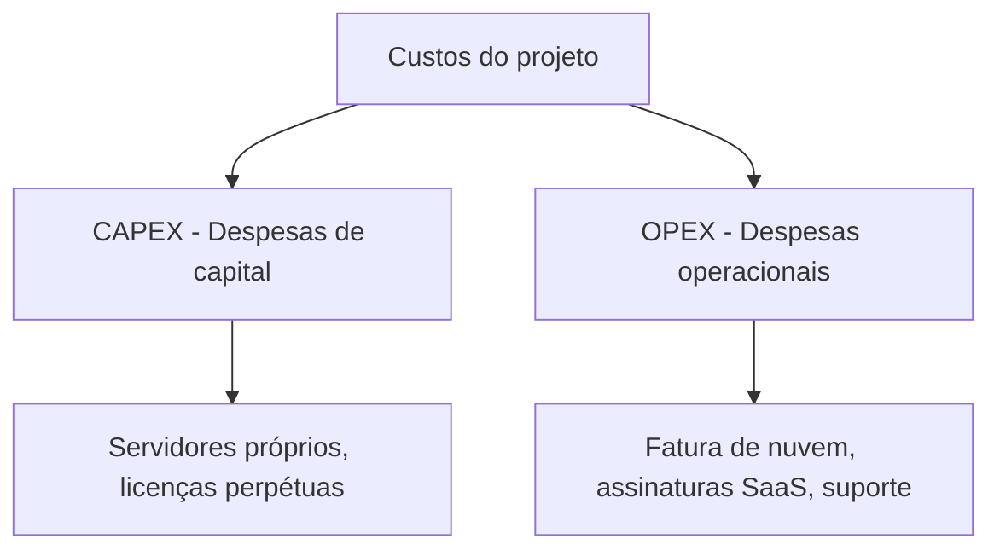

# 🧭 Conduzindo um Processo Decisório em Arquitetura

> **Módulo 01 · Fundamentos** — Como o arquiteto conduz decisões técnicas de forma objetiva: matriz de decisão, premissas e restrições, CAPEX/OPEX e registro com ADRs.

---

## 1. O papel do arquiteto na decisão

O arquiteto **ajuda, facilita e conduz** a tomada de decisão técnica. A meta não é impor preferências pessoais nem seguir modismos, mas guiar time e *stakeholders* numa análise lógica e estruturada para encontrar a solução de **maior valor para o negócio**, dentro dos limites do projeto.

### Fluxo típico de decisão

```text
1. Entender o problema e o contexto de negócio
2. Levantar premissas e restrições
3. Identificar alternativas
4. Definir critérios (características arquiteturais) e pesos
5. Avaliar (matriz de decisão, PoC, benchmarks)
6. Decidir e registrar (ADR)
7. Comunicar e acompanhar (rever se o contexto mudar)
```

> 💡 Decisões **reversíveis** (porta de duas vias) podem ser rápidas; decisões **irreversíveis** (porta de uma via) merecem análise profunda — conceito popularizado por Jeff Bezos.

---

## 2. Matriz de decisão

Ferramenta quantitativa que reduz o viés pessoal e o "achismo": lista critérios, atribui **pesos** conforme a importância para o negócio e dá **notas** a cada alternativa.

### Etapas

1. **Definir as alternativas** concorrentes;
2. **Selecionar critérios** relevantes (desempenho, custo, manutenibilidade, curva de aprendizado…);
3. **Atribuir pesos** (1 a 5) a cada critério;
4. **Pontuar** cada alternativa (1 a 5) em cada critério;
5. **Calcular**: `total = Σ (peso × nota)`.

### Exemplo: RabbitMQ × Apache Kafka

| Critério | Peso | RabbitMQ | Total | Kafka | Total |
|---|:---:|:---:|:---:|:---:|:---:|
| Facilidade de implementação | 5 | 5 | 25 | 3 | 15 |
| Alta vazão (throughput) | 4 | 3 | 12 | 5 | 20 |
| Curva de aprendizado do time | 3 | 4 | 12 | 2 | 6 |
| Roteamento complexo | 4 | 5 | 20 | 2 | 8 |
| **Total** | | | **69** | | **49** |

**Resultado:** neste contexto (time pequeno, prioridade em simplicidade e roteamento), o **RabbitMQ** vence. Num cenário de streaming com milhões de eventos/s e replay de histórico, os pesos mudariam e o Kafka poderia vencer.

> ⚠️ A matriz **apoia** a decisão, não a substitui. Pesos mal escolhidos levam a conclusões erradas — discuta os pesos com os stakeholders **antes** de pontuar.

### Outras ferramentas de apoio

- **Prova de conceito (PoC)** e *spikes* para reduzir incerteza;
- **Benchmarks** e testes de carga;
- **ATAM** (Architecture Tradeoff Analysis Method) para decisões de grande porte;
- **Technology Radar** (ThoughtWorks): classificar tecnologias em *Adopt, Trial, Assess, Hold*.

---

## 3. Premissas e restrições

| | Premissas (*assumptions*) | Restrições (*constraints*) |
|---|---|---|
| **O que é** | Hipóteses tomadas como verdadeiras para planejar, sem garantia | Limitações rígidas e inegociáveis |
| **Origem** | Estimativas, expectativas | Negócio, legislação, orçamento, infraestrutura existente |
| **Exemplo** | "Teremos até 10 mil usuários simultâneos no 1º ano" | "Conformidade com a LGPD; infraestrutura até R$ 5.000/mês" |
| **Ação** | **Validar** periodicamente; se cair, rever a decisão | **Respeitar**; só mudam por decisão de negócio |

> Premissas não documentadas são uma das maiores fontes de risco (ver [08 Gerenciamento de riscos](08%20Gerenciamento%20de%20riscos.md)).

---

## 4. Custos: CAPEX × OPEX e ROI



| | CAPEX (*Capital Expenditure*) | OPEX (*Operational Expenditure*) |
|---|---|---|
| **Natureza** | Investimento inicial, grande, em ativos | Custo contínuo e recorrente |
| **Exemplos em TI** | Servidores *bare-metal*, data center, licenças perpétuas | Nuvem (pay-as-you-go), SaaS, manutenção |
| **Característica** | Alto custo inicial, ativo deprecia | Flexível, escala com o uso |

A migração para nuvem é essencialmente uma troca de **CAPEX por OPEX**.

- **TCO (Total Cost of Ownership):** custo total ao longo da vida da solução (infra + licenças + pessoas + operação + migração).
- **ROI (Return on Investment):** `ROI = (ganho − custo) / custo × 100%`.

---

## 5. Registrando decisões — ADR

Um **ADR (Architecture Decision Record)** é um documento curto, versionado junto ao código, que registra **uma** decisão e seu porquê.

```markdown
# ADR 007 — Usar RabbitMQ como broker de mensagens

**Status:** Aceito (2026-05-10)

## Contexto
Precisamos de comunicação assíncrona entre Pedidos, Estoque e Notificações.
Time pequeno, sem experiência com Kafka. Volume previsto: 500 msg/s.

## Decisão
Adotar RabbitMQ gerenciado (Amazon MQ).

## Alternativas consideradas
- Apache Kafka: maior throughput, mas complexidade e curva de aprendizado altas.
- SQS/SNS: simples, mas roteamento limitado e lock-in.

## Consequências
+ Implantação rápida, roteamento flexível (exchanges).
− Sem replay de eventos históricos; reavaliar se o volume passar de 20 mil msg/s.
```

Status possíveis: *Proposto, Aceito, Rejeitado, Depreciado, Substituído por ADR-XXX*. ADRs **não são editados** depois de aceitos — uma nova decisão gera um novo ADR que substitui o anterior.

---

## 6. Analogia — O arquiteto como juiz

O juiz não cria as leis nem inventa os fatos: analisa as provas (critérios técnicos), ouve acusação e defesa (desenvolvedores e negócio), respeita os limites da lei (restrições) e emite uma sentença **fundamentada** (matriz de decisão + ADR), explicando o porquê.

---

## ✅ Pontos-chave

- O arquiteto **facilita** a decisão; não impõe preferências.
- Matriz de decisão = critérios × pesos × notas. Discuta os pesos antes.
- **Premissas** são validadas; **restrições** são respeitadas.
- **CAPEX** = investimento inicial; **OPEX** = custo recorrente. Avalie o **TCO**.
- Registre o porquê das decisões em **ADRs**.

## ❓ Perguntas de revisão

<details><summary>1. Qual a diferença entre premissa e restrição?</summary>
Premissa é uma hipótese assumida como verdadeira sem garantia (precisa ser validada); restrição é uma limitação obrigatória e inegociável imposta pelo contexto.
</details>

<details><summary>2. Por que migrar para a nuvem é uma troca de CAPEX por OPEX?</summary>
Porque deixa-se de investir antecipadamente em servidores e data center (capital) para pagar mensalmente pelo uso de recursos (despesa operacional).
</details>

<details><summary>3. Quais seções um ADR costuma ter?</summary>
Título, status, contexto, decisão, alternativas consideradas e consequências (positivas e negativas).
</details>

<details><summary>4. Qual o principal risco de uma matriz de decisão?</summary>
Pesos e notas enviesados levarem a uma conclusão "matematicamente" justificada mas errada; por isso pesos devem ser acordados com stakeholders antes da pontuação.
</details>

## 🔗 Relacionadas

- [03 Trade-offs arquiteturais](03%20Trade-Offs%20Arquiteturais.md)
- [08 Gerenciamento de riscos](08%20Gerenciamento%20de%20riscos.md)

## 📚 Referências

- NYGARD, M. *Documenting Architecture Decisions*, 2011. https://cognitect.com/blog/2011/11/15/documenting-architecture-decisions
- ThoughtWorks Technology Radar — https://www.thoughtworks.com/radar
