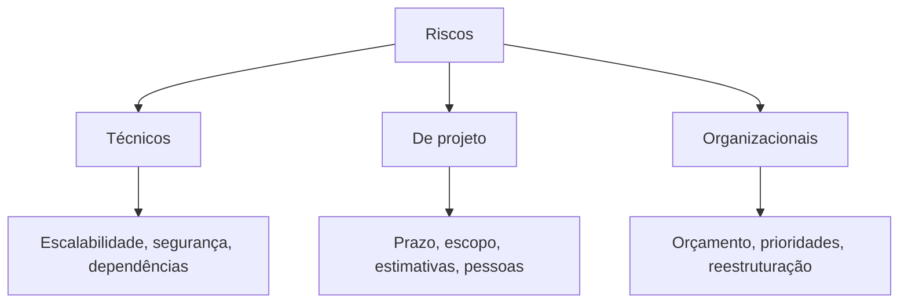
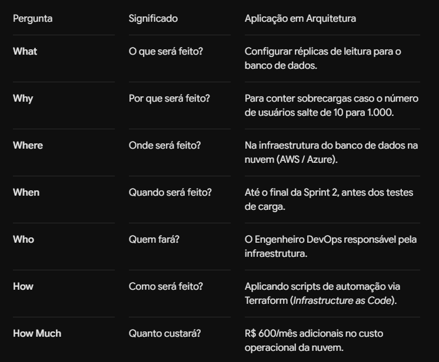

# ⚠️ Gerenciamento de Riscos em Arquitetura

> **Módulo 01 · Fundamentos** — Identificar, classificar e tratar riscos técnicos, de projeto e organizacionais: matriz probabilidade × impacto, ROAM e plano 5W2H.

---

## 1. Risco × Oportunidade

| | Risco | Oportunidade |
|---|---|---|
| **Definição** | Evento incerto que, se ocorrer, gera impacto **negativo** | Evento incerto que, se ocorrer, gera impacto **positivo** |
| **Exemplos** | Queda do serviço, perda de dados, vazamento, atraso | Redução de custo, ganho de desempenho, entrega antecipada |

> Risco ≠ problema. **Risco** é algo que *pode* acontecer; **problema** (*issue*) é algo que *já* aconteceu.

---

## 2. Tipos de riscos



| Tipo | Exemplos |
|---|---|
| **Técnicos** | Gargalo de escalabilidade, biblioteca descontinuada, falha de segurança, ponto único de falha, tecnologia nova sem domínio do time |
| **De projeto** | Estimativas erradas, mudança desordenada de escopo, dependência de pessoa-chave (*bus factor*) |
| **Organizacionais** | Corte de orçamento, fusão, mudança de prioridade estratégica, troca de fornecedor |
| **Externos / regulatórios** | Nova lei (LGPD), mudança de preço do provedor de nuvem, falha de terceiro |

---

## 3. Como identificar riscos

- **Análise SWOT (FOFA):** Forças e Fraquezas (internas) × Oportunidades e Ameaças (externas);
- **Diagramas de fluxo e casos de uso:** seguir o caminho da requisição para encontrar gargalos, integrações frágeis e **SPOFs** (*Single Points of Failure*);
- **Risk storming** (Richards & Ford): colaborativo — cada participante marca riscos no diagrama da arquitetura individualmente, depois o grupo consolida e discute;
- **Premissas não validadas** (ver [07 Processo decisório](07%20Conduzindo%20um%20processo%20decis%C3%B3rio.md)): toda premissa é um risco em potencial;
- **Threat modeling (STRIDE)** para riscos de segurança;
- **Lições aprendidas e post-mortems** de incidentes anteriores.

---

## 4. Classificação: Probabilidade × Impacto

```text
Nível do risco = Probabilidade × Impacto
```

- **Probabilidade (1–5):** chance de ocorrer (histórico, complexidade, dados).
- **Impacto (1–5):** severidade financeira, operacional ou de reputação.

### Matriz de riscos

| Probabilidade ↓ / Impacto → | 1 Insignificante | 2 Baixo | 3 Moderado | 4 Alto | 5 Catastrófico |
|---|:---:|:---:|:---:|:---:|:---:|
| **5 Quase certo** | 5 🟡 | 10 🟠 | 15 🔴 | 20 🔴 | 25 🔴 |
| **4 Provável** | 4 🟢 | 8 🟡 | 12 🟠 | 16 🔴 | 20 🔴 |
| **3 Possível** | 3 🟢 | 6 🟡 | 9 🟠 | 12 🟠 | 15 🔴 |
| **2 Improvável** | 2 🟢 | 4 🟢 | 6 🟡 | 8 🟡 | 10 🟠 |
| **1 Raro** | 1 🟢 | 2 🟢 | 3 🟢 | 4 🟢 | 5 🟡 |

🟢 baixo · 🟡 médio · 🟠 alto · 🔴 crítico — trate primeiro os vermelhos.

### Exemplo de registro de riscos

| ID | Risco | P | I | Nível | Tratamento |
|---|---|:-:|:-:|:-:|---|
| R1 | Banco único sem réplica (SPOF) | 3 | 5 | 15 🔴 | **Mitigar:** réplica multi-AZ + backup automático |
| R2 | API de frete externa instável | 4 | 3 | 12 🟠 | **Mitigar:** circuit breaker + cache de cotação |
| R3 | Só um dev conhece o módulo fiscal | 3 | 4 | 12 🟠 | **Owned:** tech lead responsável por pareamento e documentação |
| R4 | Lentidão no relatório anual (1×/ano) | 2 | 2 | 4 🟢 | **Aceitar** |

---

## 5. Tratamento — ROAM

Usado no SAFe para dar destino a cada risco:

| Letra | Significado | Exemplo |
|---|---|---|
| **R – Resolved** | Eliminado (o risco deixou de existir) | Trocar a biblioteca descontinuada |
| **O – Owned** | Não resolvido agora, mas tem **dono** que monitora | Tech lead acompanha o uso de disco semanalmente |
| **A – Accepted** | Entendido; custo de tratar > impacto | Aceitar lentidão no relatório anual |
| **M – Mitigated** | Ações reduzem probabilidade ou impacto | Réplica de banco, retries, rate limiting |

Equivalente no PMBOK (riscos negativos): **evitar, transferir** (ex.: seguro, serviço gerenciado), **mitigar, aceitar**.

---

## 6. Plano de ação — 5W2H



| Pergunta | Significado | Exemplo (R1 — banco sem réplica) |
|---|---|---|
| **What** (o quê) | Ação | Configurar réplica Multi-AZ do PostgreSQL |
| **Why** (por quê) | Justificativa | Eliminar SPOF; RTO alvo < 5 min |
| **Where** (onde) | Local | AWS RDS, região sa-east-1 |
| **When** (quando) | Prazo | Até a sprint 14 |
| **Who** (quem) | Responsável | Time de plataforma (João) |
| **How** (como) | Método | Terraform + teste de failover em staging |
| **How much** (quanto) | Custo | +R$ 900/mês |

---

## 7. Analogia — Piloto de avião

- **Risco:** tempestade na rota. **Oportunidade:** vento de cauda que economiza combustível.
- **Checklist pré-voo:** inspeção preventiva (diagramas de fluxo).
- **ROAM:** *Resolved* = trocar peça defeituosa antes de decolar; *Owned* = copiloto checa combustível a cada 30 min; *Accepted* = leve turbulência; *Mitigated* = desviar da tempestade.
- **5W2H:** o plano de voo entregue à torre (rota alternativa, comandante, aeroporto de emergência, combustível de reserva).

---

## ✅ Pontos-chave

- Riscos podem ser técnicos, de projeto, organizacionais ou externos.
- **Nível = probabilidade × impacto**; priorize os críticos.
- **ROAM**: Resolved, Owned, Accepted, Mitigated.
- **5W2H** transforma o tratamento em plano de ação concreto.
- Gerenciar riscos é contínuo: revise o registro periodicamente.

## ❓ Perguntas de revisão

<details><summary>1. Qual a diferença entre risco e problema?</summary>
Risco é um evento incerto futuro; problema é algo que já aconteceu e precisa ser resolvido.
</details>

<details><summary>2. O que significa um risco "Owned" no ROAM?</summary>
Que ainda não foi resolvido, mas foi atribuído a um responsável que o monitora e age se necessário.
</details>

<details><summary>3. Um risco com probabilidade 2 e impacto 5 tem qual nível? Como tratar?</summary>
Nível 10 (alto). Mesmo improvável, o impacto catastrófico justifica mitigação ou plano de contingência (ex.: backup e DR).
</details>

<details><summary>4. O que é risk storming?</summary>
Técnica colaborativa em que os participantes identificam riscos individualmente sobre o diagrama da arquitetura e depois consolidam e discutem em grupo.
</details>

## 🔗 Relacionadas

- [07 Conduzindo um processo decisório](07%20Conduzindo%20um%20processo%20decis%C3%B3rio.md)
- [Padrões para sistemas distribuídos (circuit breaker, retry)](../03%20Design%20patterns,%20estilos%20e%20padroes%20arquiteturais/08%20Padr%C3%B5es%20para%20sistemas%20distribuidos.md)

## 📚 Referências

- PMI. *PMBOK Guide*. 7ª ed., 2021.
- RICHARDS, M.; FORD, N. *Fundamentals of Software Architecture* — cap. 20 (Analyzing Architecture Risk).
