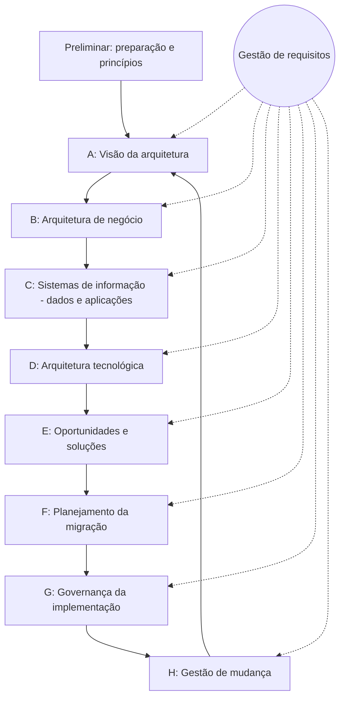

# 🏛️ Arquitetura Corporativa: TOGAF e Zachman

> **Módulo 01 · Fundamentos** — Frameworks de Arquitetura Corporativa (EA): Zachman como taxonomia para classificar artefatos e TOGAF como método para criar e governar a arquitetura.

---

## 1. Arquitetura Corporativa (Enterprise Architecture — EA)

A **Arquitetura Corporativa** alinha a **estratégia de negócio** às tecnologias, dados, processos e sistemas da empresa. Responde: *"Onde estamos (As-Is), onde queremos chegar (To-Be) e como migrar?"*

### Níveis de arquitetura

| Nível | Foco | Quem |
|---|---|---|
| **Corporativa (Enterprise)** | Toda a organização, portfólio de sistemas | Arquiteto corporativo |
| **Soluções** | Uma solução de negócio que integra vários sistemas | Arquiteto de soluções |
| **Software** | Estrutura interna de um sistema | Arquiteto de software |

### Domínios da EA (BDAT)

- **B**usiness — processos, capacidades, organização;
- **D**ata — dados e informação;
- **A**pplication — sistemas e integrações;
- **T**echnology — infraestrutura, redes, nuvem.

---

## 2. Zachman Framework — a taxonomia

Criado por John Zachman (IBM, 1987). **Não é metodologia** (não diz *como* fazer): é uma **matriz 6 × 6** que classifica os artefatos da empresa para garantir que nenhuma perspectiva seja esquecida.

### Colunas — as perguntas fundamentais

| Pergunta | Foco |
|---|---|
| **What** (o quê) | Dados |
| **How** (como) | Funções / processos |
| **Where** (onde) | Rede / localização |
| **Who** (quem) | Pessoas / papéis |
| **When** (quando) | Tempo / eventos |
| **Why** (por quê) | Motivação / regras e objetivos |

### Linhas — as perspectivas

| Linha | Perspectiva | Visão |
|---|---|---|
| 1 | **Planner** (planejador) | Escopo / contexto |
| 2 | **Owner** (dono) | Modelo de negócio (conceitual) |
| 3 | **Designer** (projetista) | Modelo do sistema (lógico) |
| 4 | **Builder** (construtor) | Modelo tecnológico (físico) |
| 5 | **Subcontractor** | Especificações detalhadas |
| 6 | **User** | Sistema em funcionamento |

**Exemplo de célula:** linha *Designer* × coluna *What* = modelo lógico de dados (diagrama ER). Linha *Builder* × *What* = esquema físico do banco (DDL).

---

## 3. TOGAF — o método

**TOGAF** (*The Open Group Architecture Framework*) é um framework baseado em **processo**. Seu coração é o **ADM (*Architecture Development Method*)**, um ciclo iterativo.

| Fase | O que faz |
|---|---|
| **Preliminar** | Prepara a organização: princípios, frameworks, equipe |
| **A — Visão** | Escopo, stakeholders, visão macro, aprovação (*Statement of Architecture Work*) |
| **B — Negócio** | Processos e capacidades As-Is e To-Be |
| **C — Sistemas de informação** | Arquitetura de **dados** e de **aplicações** |
| **D — Tecnologia** | Infraestrutura, redes, plataformas, nuvem |
| **E — Oportunidades e soluções** | Identifica projetos e agrupa em *transition architectures* |
| **F — Migração** | Roadmap priorizado, custos e benefícios |
| **G — Governança** | Garante que a implementação siga a arquitetura |
| **H — Gestão de mudança** | Monitora mudanças e decide se reinicia o ciclo |
| **Gestão de requisitos** (centro) | Alimenta e é alimentada por todas as fases |

### Outros conceitos do TOGAF

- **Gap analysis:** diferença entre As-Is e To-Be em cada fase;
- **Enterprise Continuum:** classifica artefatos do mais genérico (fundação) ao mais específico (organização);
- **Architecture Repository:** onde ficam modelos, padrões e decisões;
- **Architecture Board:** comitê de governança.

---

## 4. Zachman × TOGAF

| | Zachman | TOGAF |
|---|---|---|
| **Natureza** | Taxonomia / ontologia (o **quê** documentar) | Metodologia / processo (**como** fazer) |
| **Estrutura** | Matriz 6×6 | Ciclo ADM de fases |
| **Uso** | Checar completude dos artefatos | Conduzir e governar a arquitetura |
| **Complementares?** | Sim — usa-se o ADM para produzir artefatos que são classificados na matriz Zachman |

> Outros frameworks: **ArchiMate** (linguagem de modelagem do Open Group, usada com TOGAF), **FEAF** (governo dos EUA), **DoDAF** (defesa).

---

## 5. Analogia — Construção de um arranha-céu

- **Zachman = a pasta de arquivos do engenheiro:** gavetas rotuladas com a visão do dono (custo, finalidade), do eletricista (diagrama elétrico), do encanador (tubulação). Garante que nenhum desenho falte.
- **TOGAF = o cronograma e a gestão da obra:** sondagem do solo (A), projetos (B, C, D), compras e cronograma (E, F) e fiscalização dos pedreiros (G, H).

---

## ✅ Pontos-chave

- EA alinha estratégia de negócio e TI; domínios **BDAT**.
- **Zachman:** matriz 6×6 (perguntas × perspectivas); classifica, não diz como fazer.
- **TOGAF:** método ADM iterativo com fases Preliminar e A–H, requisitos no centro.
- São **complementares**.

## ❓ Perguntas de revisão

1. Por que o Zachman não é considerado uma metodologia?

Porque apenas classifica artefatos em uma matriz (o que documentar e sob qual perspectiva), sem definir um processo de como produzi-los.

2. Quais são as seis perguntas (colunas) do Zachman?

What, How, Where, Who, When, Why.

3. Em qual fase do ADM se definem arquiteturas de dados e aplicações?

Fase C — Arquitetura de Sistemas de Informação.

4. O que é gap analysis no TOGAF?

A comparação entre o estado atual (As-Is) e o desejado (To-Be) para identificar o que precisa ser criado, alterado ou eliminado.

## 🔗 Relacionadas

- [01 Introdução](01%20Introducao.md)
- [07 Conduzindo um processo decisório](07%20Conduzindo%20um%20processo%20decis%C3%B3rio.md)

## 📚 Referências

- The Open Group. *The TOGAF Standard*, 10ª ed. https://www.opengroup.org/togaf
- ZACHMAN, J. A. *A Framework for Information Systems Architecture*. IBM Systems Journal, 1987.
