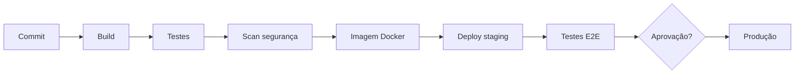

# ♾️ DevOps: Cultura, Práticas e Arquitetura

> **Módulo 01 · Fundamentos** — DevOps como cultura que une desenvolvimento e operações: CI/CD, observabilidade, infraestrutura como código e estratégias de deploy.

---

## 1. O problema antes do DevOps

O **"muro da confusão"** separava dois silos:

- **Dev:** focado em velocidade e novas funcionalidades;
- **Ops:** focado em estabilidade e em evitar quedas.

Resultado: Dev queria subir mudanças todo dia, Ops queria congelar o ambiente → deploys manuais, raros, demorados e com muitos erros ("na minha máquina funciona").

## 2. O que é DevOps

DevOps **não é cargo nem ferramenta**: é uma **cultura** que une responsabilidades — *"You build it, you run it"* (Werner Vogels, Amazon).

**Objetivo:** entregar software de qualidade de forma **rápida, frequente, contínua e segura**.

### Modelo CALMS

| Letra | Pilar |
|---|---|
| **C**ulture | Colaboração, responsabilidade compartilhada, cultura sem culpados (*blameless*) |
| **A**utomation | Automatizar build, testes, deploy e infraestrutura |
| **L**ean | Lotes pequenos, eliminar desperdício, fluxo contínuo |
| **M**easurement | Medir tudo: métricas de entrega e de produção |
| **S**haring | Compartilhar conhecimento e ferramentas |

### Os 5 pilares práticos

1. **Automação** de tarefas repetitivas;
2. **Integração Contínua (CI)**;
3. **Entrega Contínua (CD)**;
4. **Monitoramento e feedback**;
5. **Segurança desde o início (DevSecOps / shift-left)**.

### Métricas DORA

Indicadores (pesquisa *Accelerate*) do desempenho de times de entrega:

| Métrica | Elite |
|---|---|
| **Frequência de deploy** | Sob demanda (várias vezes ao dia) |
| **Lead time para mudanças** (commit → produção) | Menos de 1 dia |
| **Taxa de falha em mudanças** | 0–15% |
| **Tempo para restaurar o serviço (MTTR)** | Menos de 1 hora |

---

## 3. Integração Contínua (CI)

Integrar o código de todos no repositório principal **várias vezes ao dia**, com build e testes automáticos — *fail fast*.

```text
commit/push → build → testes unitários → lint/análise estática → testes integração → artefato
```

**Regra de ouro:** build ou teste quebrado = mudança rejeitada até correção; consertar o build é prioridade do time.

**Ferramentas:** GitHub Actions, GitLab CI, Jenkins, CircleCI, Azure DevOps.

```yaml
# .github/workflows/ci.yml
name: CI
on: [push, pull_request]
jobs:
  build:
    runs-on: ubuntu-latest
    steps:
      - uses: actions/checkout@v4
      - uses: actions/setup-node@v4
        with: { node-version: 20 }
      - run: npm ci
      - run: npm run lint
      - run: npm test
```

---

## 4. Entrega × Implantação Contínua (CD)

| | Continuous **Delivery** | Continuous **Deployment** |
|---|---|---|
| Ida para produção | **Aprovação manual** (um clique) | **Automática** — passou nos testes, vai ao ar |
| Automação | Até staging | Até produção |

Benefícios: deploys pequenos e frequentes (menor risco), rollback fácil.
Ferramentas: ArgoCD, Flux (GitOps), GitLab CD, Jenkins, Octopus Deploy, Spinnaker.

### Pipeline completo



---

## 5. Infraestrutura como Código (IaC)

Infraestrutura definida em arquivos versionados, revisada e aplicada automaticamente.

| Tipo | Ferramentas |
|---|---|
| **Provisionamento** (criar recursos) | Terraform/OpenTofu, CloudFormation, Pulumi, Bicep |
| **Configuração** (configurar servidores) | Ansible, Chef, Puppet |
| **Containers e orquestração** | Docker, Kubernetes, Helm |

```hcl
resource "aws_s3_bucket" "logs" {
  bucket = "minha-app-logs"
  tags   = { ambiente = "producao" }
}
```

**Infraestrutura imutável:** servidores não são alterados em produção; para atualizar, cria-se uma nova versão e destrói-se a antiga. Evita *configuration drift* ("servidores floco de neve").

---

## 6. Observabilidade

| Pilar | Pergunta | Ferramentas |
|---|---|---|
| **Métricas** | *O que* está acontecendo? (CPU, req/s, latência p95) | Prometheus, CloudWatch |
| **Logs** | *O que* deu errado exatamente? | ELK (Elasticsearch, Logstash, Kibana), Loki |
| **Traces** | *Onde* está o gargalo entre serviços? | Jaeger, Tempo, Zipkin |

- **Visualização:** Grafana. **Padrão aberto de coleta:** OpenTelemetry.
- **Monitoramento × observabilidade:** monitoramento responde perguntas conhecidas ("o servidor caiu?"); observabilidade permite investigar perguntas novas a partir dos dados.
- **SLI / SLO / SLA:** indicador medido (latência), objetivo interno (99,9% < 300 ms) e contrato com o cliente (com penalidade).

---

## 7. Arquitetura para DevOps

### Arquitetura evolutiva

Mudanças estruturais só são seguras com testes e pipelines eficientes.

- **Desacoplamento:** componentes independentes ("blocos de Lego");
- **Feedback contínuo:** testes automatizados e *fitness functions*;
- **Governança mínima:** times autônomos, sem burocracia central excessiva.

### Princípios

- **Escalabilidade horizontal** e **auto scaling** conforme a demanda;
- **Resiliência:** aceitar que falhas acontecem e recuperar automaticamente (health checks, réplicas, self-healing);
- **Aplicações stateless** e configuração por variáveis de ambiente (12 fatores);
- **Descentralização das decisões** técnicas para os times.

---

## 8. Estratégias de deploy

| Estratégia | Como funciona | Vantagem | Custo / risco |
|---|---|---|---|
| **Recreate** | Derruba a versão antiga e sobe a nova | Simples | Downtime |
| **Rolling update** | Substitui instâncias aos poucos | Sem downtime, padrão no Kubernetes | Duas versões convivem durante o rollout |
| **Blue-Green** | Dois ambientes idênticos; troca o roteamento do Blue para o Green | Zero downtime, **rollback instantâneo** | Dobro de infraestrutura; cuidado com migrações de banco |
| **Canary** | Nova versão para uma fração dos usuários (5% → 20% → 50% → 100%) | Reduz o **raio de impacto** (*blast radius*) | Exige métricas boas e roteamento por peso |
| **Feature flags** | Código vai para produção desligado; liga-se por configuração | Separa *deploy* de *release*; testes A/B | Dívida técnica se flags não forem removidas |

---

## ✅ Pontos-chave

- DevOps é **cultura** (CALMS), apoiada por automação.
- **CI** integra e testa sempre; **CD** mantém o software pronto (Delivery) ou já publica (Deployment).
- **IaC** e infraestrutura imutável eliminam configuração manual.
- Observabilidade = **métricas, logs e traces**.
- Blue-Green e Canary reduzem o risco dos deploys; meça com as **métricas DORA**.

## ❓ Perguntas de revisão

<details><summary>1. Qual a diferença entre Continuous Delivery e Continuous Deployment?</summary>
Na Delivery, a ida para produção exige aprovação manual; no Deployment, toda mudança que passa nos testes vai automaticamente para produção.
</details>

<details><summary>2. Quais são as quatro métricas DORA?</summary>
Frequência de deploy, lead time para mudanças, taxa de falha em mudanças e tempo para restaurar o serviço.
</details>

<details><summary>3. Quando preferir Canary a Blue-Green?</summary>
Quando se quer expor a nova versão gradualmente a poucos usuários, observando métricas reais antes de liberar para todos, limitando o raio de impacto de um bug.
</details>

<details><summary>4. O que é infraestrutura imutável?</summary>
Servidores nunca são alterados após criados; para mudar, cria-se uma nova instância a partir de código/imagem e descarta-se a antiga, evitando configuration drift.
</details>

<details><summary>5. Qual a diferença entre SLO e SLA?</summary>
SLO é o objetivo interno de nível de serviço; SLA é o acordo contratual com o cliente, normalmente com penalidades se não cumprido.
</details>

## 🔗 Relacionadas

- [04 Arquiteturas modernas (fitness functions)](04%20Arquiteturas%20modernas.md)
- [Arquiteturas cloud e serverless](../04%20Arquiteturas%20da%20atualidade/05%20Arquiteturas%20cloud%20e%20serverless.md)

## 📚 Referências

- FORSGREN, N.; HUMBLE, J.; KIM, G. *Accelerate*. IT Revolution, 2018.
- KIM, G. et al. *The DevOps Handbook*. 2ª ed. IT Revolution, 2021.
- Google. *Site Reliability Engineering*. https://sre.google/books
