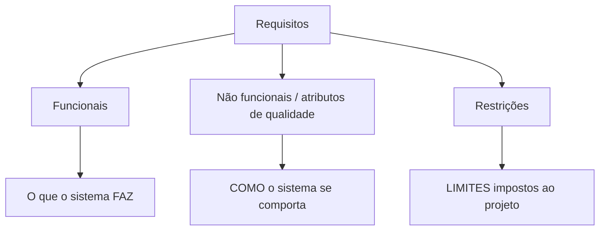
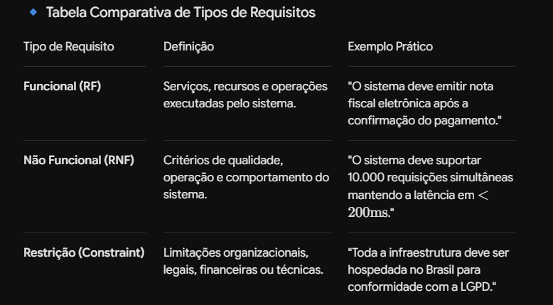

# 📋 Requisitos Arquiteturais: Fundamentos e Elicitação

> **Módulo 02 · Requisitos** — Requisitos funcionais, não funcionais e restrições; como identificar os ASRs e documentá-los como cenários de qualidade mensuráveis.

---

## 1. Engenharia de requisitos na arquitetura

A **Engenharia de Requisitos** elicita, analisa, documenta e valida as necessidades do negócio, transformando expectativas de *stakeholders* em especificações **testáveis**.

Na arquitetura, o foco são os **ASRs (*Architecturally Significant Requirements*)**: requisitos que impõem restrições profundas à estrutura do sistema e cuja mudança custa caro depois de implementada.

### Processo

```text
Elicitação → Análise/Negociação → Especificação → Validação → Gestão de mudanças
```

---

## 2. Classificação dos requisitos





| Tipo | Definição | Exemplo |
|---|---|---|
| **Funcional (RF)** | Comportamento/função do sistema | "O cliente deve poder finalizar a compra com Pix" |
| **Não funcional (RNF)** | Qualidade com que a função é entregue | "O checkout deve responder em até 2 s no p95" |
| **Restrição** | Decisão já tomada, inegociável | "Deve rodar na AWS", "Deve ser em Java", "Conformidade LGPD" |

> 💡 Requisitos funcionais raramente definem a arquitetura sozinhos — quase qualquer estrutura consegue "cadastrar um pedido". Quem molda a arquitetura são os **RNFs e as restrições**.

### Classificação FURPS+

- **F**unctionality, **U**sability, **R**eliability, **P**erformance, **S**upportability;
- **+**: restrições de design, implementação, interface e físicas.

---

## 3. Identificando ASRs

Um requisito é arquiteturalmente significativo quando tem:

- **Alto impacto estrutural:** exige escolhas de estilo, infraestrutura ou padrões (ex.: 1 milhão de usuários simultâneos → escala horizontal, cache, filas);
- **Alto custo de mudança:** alterar depois exigiria grande refatoração;
- **Alta prioridade de negócio:** vital para o produto;
- **Alto risco técnico ou incerteza.**

### Fontes de ASRs

- Documentos de requisitos e user stories (procurar palavras como "sempre", "todos", "em tempo real", "nunca");
- Entrevistas com stakeholders;
- Entendimento dos objetivos de negócio;
- **QAW (Quality Attribute Workshop)** — workshop do SEI que reúne stakeholders para levantar e priorizar cenários de qualidade;
- **Utility tree** (árvore de utilidade) — usada no ATAM.

### Utility tree (exemplo)

```text
Utilidade
├── Desempenho
│   └── (A,M) Checkout responde em < 2 s com 5 mil usuários simultâneos
├── Disponibilidade
│   └── (A,A) Pagamento disponível 99,95% do tempo
└── Segurança
    └── (A,B) Dados de cartão nunca armazenados (PCI-DSS)
(importância para o negócio, dificuldade técnica): A=alta, M=média, B=baixa
```

Os itens **(A,A)** são os primeiros a orientar a arquitetura.

---

## 4. Atributos de qualidade comuns

| Atributo | Pergunta | Exemplo de métrica |
|---|---|---|
| **Desempenho** | Quão rápido? | Latência p95, throughput (req/s) |
| **Escalabilidade** | Aguenta crescer? | Usuários simultâneos suportados |
| **Disponibilidade** | Quanto tempo no ar? | 99,9% ("três noves") |
| **Segurança** | Protege dados e acesso? | Autenticação, autorização, auditoria |
| **Manutenibilidade** | Fácil de mudar? | Tempo para implementar mudança, cobertura de testes |
| **Usabilidade** | Fácil de usar? | Taxa de conclusão de tarefa |
| **Interoperabilidade** | Integra com outros? | Padrões suportados (REST, OpenAPI) |

### Tabela de disponibilidade ("noves")

| Disponibilidade | Downtime por ano | Por mês |
|---|---|---|
| 99% | 3,65 dias | 7,3 h |
| 99,9% | 8,76 h | 43,8 min |
| 99,99% | 52,6 min | 4,4 min |
| 99,999% | 5,26 min | 26 s |

---

## 5. Cenários de atributos de qualidade (6 partes)

"O sistema deve ser rápido" é ambíguo e não testável. Documente ASRs como **cenários**:

| Parte | Descrição | Exemplo |
|---|---|---|
| **1. Fonte do estímulo** | Quem/o que gera a ação | Usuário anônimo |
| **2. Estímulo** | O evento | Tenta fazer login |
| **3. Artefato** | Parte afetada | Serviço de autenticação |
| **4. Ambiente** | Condições | Carga normal de operação |
| **5. Resposta** | Comportamento esperado | Valida credenciais e gera token JWT |
| **6. Medida da resposta** | Métrica mensurável | Em até 150 ms no p95 |

### Outro exemplo — disponibilidade

> *Fonte:* falha de hardware · *Estímulo:* instância do banco cai · *Artefato:* banco de pedidos · *Ambiente:* horário de pico · *Resposta:* failover automático para a réplica · *Medida:* indisponibilidade < 60 s, sem perda de transações confirmadas.

---

## 6. Analogia — Carro de corrida × carro de família

- **Requisito funcional:** transportar pessoas de A a B e frear (ambos fazem).
- **Requisito não funcional:** atingir 300 km/h.
- **Restrição:** custo por unidade até R$ 80.000.
- **ASR:** fazer curvas a 200 km/h sem capotar — obriga a rebaixar o centro de gravidade, usar aerofólios e mudar o chassi desde a base. Não dá para transformar um SUV nisso depois de pronto.
- **QAW:** reunir piloto (usuário), engenheiro (DevOps) e patrocinador (negócio) para decidir se a prioridade é velocidade ou economia.

---

## ✅ Pontos-chave

- RF = o que faz; RNF = como se comporta; restrição = limite imposto.
- **ASRs** moldam a arquitetura: alto impacto, alto custo de mudança, alta prioridade.
- Escreva atributos de qualidade como **cenários de 6 partes**, sempre com medida.
- QAW e utility tree ajudam a levantar e priorizar ASRs.

## ❓ Perguntas de revisão

<details><summary>1. Por que "o sistema deve ser rápido" é um requisito ruim?</summary>
Porque é ambíguo e não mensurável; não há como testar nem decidir a arquitetura. Deve virar um cenário com medida (ex.: p95 < 300 ms com 1.000 usuários simultâneos).
</details>

<details><summary>2. Quais são as 6 partes de um cenário de qualidade?</summary>
Fonte do estímulo, estímulo, artefato, ambiente, resposta e medida da resposta.
</details>

<details><summary>3. Quanto downtime anual permite 99,9% de disponibilidade?</summary>
Cerca de 8,76 horas por ano.
</details>

<details><summary>4. "O sistema deve usar PostgreSQL" é RF, RNF ou restrição?</summary>
Restrição — é uma decisão técnica já imposta, não um comportamento nem um atributo de qualidade.
</details>

## 🔗 Relacionadas

- [02 MVP e MVA](02%20MVP.md)
- [Trade-offs arquiteturais](../01%20Fundamentos%20em%20arquitetura%20de%20software/03%20Trade-Offs%20Arquiteturais.md)

## 📚 Referências

- BASS, L.; CLEMENTS, P.; KAZMAN, R. *Software Architecture in Practice*. 4ª ed. — caps. 3 e 19.
- SOMMERVILLE, I. *Engenharia de Software*. 10ª ed. Pearson, 2018.
