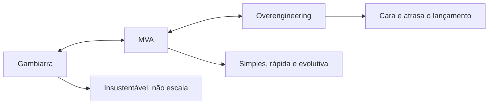

# 🚚 MVP e Arquitetura Mínima Viável (MVA)

> **Módulo 02 · Requisitos** — Como desenhar a arquitetura de um MVP: nem gambiarra, nem overengineering.

---

## 1. Conceitos

- **MVP (Minimum Viable Product):** versão enxuta do produto para **validar uma hipótese de negócio** com usuários reais, com o mínimo de tempo e recursos. Ciclo do *Lean Startup*: **Construir → Medir → Aprender**.
- **MVA (Minimum Viable Architecture):** estrutura técnica **mínima, flexível e sustentável** que suporta o MVP sem desperdício, mas sem fechar portas para evoluir.

> O MVP **não** é "um produto mal feito": é o menor produto que gera **aprendizado validado**. Ex.: o primeiro Dropbox foi um vídeo demonstrando a ideia; a primeira Zappos comprava sapatos em lojas depois que o cliente pedia no site.

### Variações

| Termo | Ideia |
|---|---|
| **MVP** | Mínimo para validar a hipótese |
| **MLP** (*Minimum Lovable Product*) | Mínimo que o usuário **goste** de usar |
| **MMP** (*Minimum Marketable Product*) | Mínimo que pode ser **vendido** |
| **PoC** | Prova técnica de que algo é possível (não vai para usuário) |
| **Protótipo** | Simulação da experiência (ex.: Figma) |

---

## 2. O dilema da arquitetura em MVPs



| Abordagem | Características | Quando ocorre | Impacto |
|---|---|---|---|
| **Subdimensionada** | Sem padrões, sem testes, sem camadas | Pressão extrema por prazo | Se o MVP der certo, é preciso reescrever tudo |
| **Overengineering** | Microsserviços, Kubernetes e vários bancos para 100 usuários | Ansiedade de escalar como Big Tech | Custo alto, lentidão, complexidade |
| **MVA (ideal)** | Monólito modular, CI/CD simples, banco relacional, serviços gerenciados | Foco nos ASRs atuais | Lança rápido e cresce de forma orgânica |

> **YAGNI** (*You Aren't Gonna Need It*): não construa hoje o que ainda não é necessário. Mas deixe **pontos de extensão** (interfaces, módulos bem delimitados) para quando for.

---

## 3. Princípios da MVA

1. **Foque nos ASRs atuais**, não nos imaginados para daqui a 5 anos;
2. **Decisões reversíveis primeiro**; adie as irreversíveis até ter dados (*last responsible moment*);
3. **Use serviços gerenciados/PaaS/SaaS** (autenticação, banco, filas) em vez de construir;
4. **Modularize** o monólito para permitir extrair serviços depois;
5. **Registre as decisões e a dívida técnica assumida** (ADRs), para pagá-la conscientemente;
6. **Meça**: o MVP existe para aprender, então observabilidade e analytics são parte da MVA.

### O mínimo que já nasce com o MVP

- **Segurança básica:** autenticação, HTTPS, proteção de dados pessoais (LGPD);
- **Observabilidade simplificada:** logs centralizados, alertas de disponibilidade, métricas de uso;
- **Pipeline CI/CD simples** e ambientes reproduzíveis (Docker);
- **Backup** do banco.

### O que pode esperar

- Desempenho extremo (cache distribuído, sharding) → otimize consultas SQL até ter carga real;
- Multi-região, alta disponibilidade avançada;
- Microsserviços.

### Exemplo de stack MVA

```text
Front (Next.js na Vercel)
      ↓
Monólito modular (Node/NestJS em container no Render / App Runner)
  ├── módulo usuarios
  ├── módulo pedidos
  └── módulo pagamentos → Stripe / Mercado Pago (SaaS)
      ↓
PostgreSQL gerenciado (RDS / Supabase)  +  Auth gerenciado (Auth0 / Cognito)
Logs: serviço gerenciado · CI/CD: GitHub Actions
```

---

## 4. Analogia — Food truck

- **MVP:** vender um hambúrguer artesanal para testar se a receita agrada antes de alugar um restaurante.
- **Gambiarra:** mesa dobrável na rua, sem higiene nem caixa — chove ou a demanda sobe e tudo colapsa.
- **Overengineering:** galpão industrial de R$ 2 milhões e 10 chefs antes de vender o primeiro sanduíche.
- **MVA:** van adaptada com chapa, geladeira e maquininha de cartão. Atende as normas, funciona bem e, se der certo, a operação migra para um restaurante fixo.

---

## ✅ Pontos-chave

- MVP valida **hipótese de negócio**; MVA é a arquitetura **mínima e evolutiva** que o sustenta.
- Evite os dois extremos: gambiarra e overengineering.
- Use serviços gerenciados, monólito modular e decisões reversíveis.
- Segurança básica e observabilidade **não** são opcionais nem no MVP.

## ❓ Perguntas de revisão

<details><summary>1. Qual a diferença entre MVP e PoC?</summary>
MVP é um produto mínimo para validar hipótese de negócio com usuários reais; PoC prova que algo é tecnicamente viável, sem foco em usuário final.
</details>

<details><summary>2. Por que microsserviços costumam ser má escolha para um MVP?</summary>
Adicionam custo e complexidade operacional enquanto o domínio ainda é incerto; fronteiras erradas entre serviços são caras de corrigir. Um monólito modular entrega mais rápido e permite extração futura.
</details>

<details><summary>3. O que é o "último momento responsável"?</summary>
Adiar decisões irreversíveis até o ponto em que adiar mais causaria prejuízo, para decidir com o máximo de informação.
</details>

## 🔗 Relacionadas

- [01 Requisitos arquiteturais](01%20Introducao.md)
- [Estilo monolítico e monólito modular](../01%20Fundamentos%20em%20arquitetura%20de%20software/05%20Estilo%20arquitetural%20monolitico.md)
- [Projeto final — módulo 1](../projeto_final_pos_mod_1/README.md)

## 📚 Referências

- RIES, E. *A Startup Enxuta*. Leya, 2012.
- ERDER, M.; PUREUR, P. *Continuous Architecture in Practice*. Addison-Wesley, 2021.
