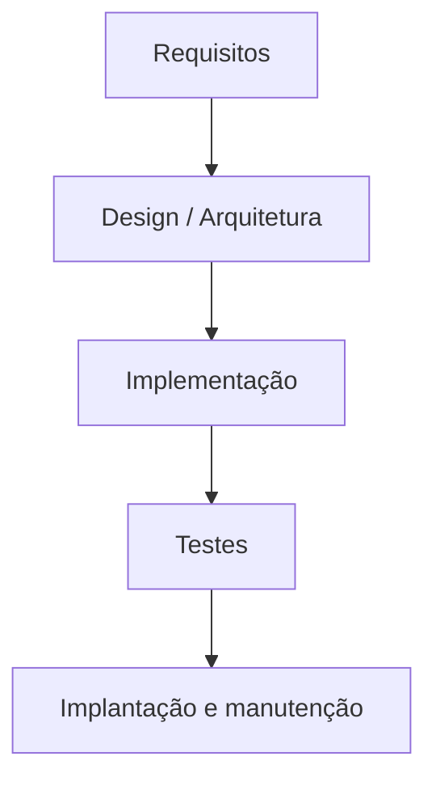
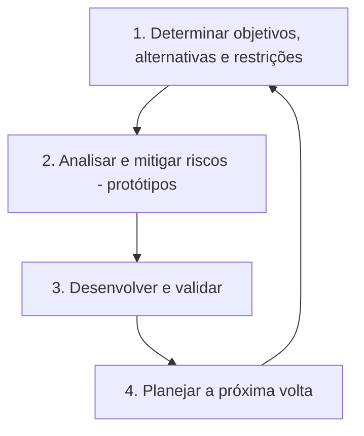

# 🔄 Metodologias na Construção do Software

> **Módulo 02 · Requisitos** — Cascata, Ágil (Scrum, Kanban, XP) e Espiral: como cada um lida com requisitos e com a arquitetura.

---

As metodologias definem **como os requisitos são elicitados, documentados, priorizados e transformados em software** ao longo do tempo — e, por consequência, quando e como as decisões arquiteturais são tomadas.

## 1. Modelo em Cascata (Waterfall)

Fases sequenciais e rígidas; uma só começa quando a anterior termina.



- **Requisitos:** especificação completa no início (BDUF). Requisitos "congelados" evitam escopo aberto, mas geram alto risco se o negócio mudar.
- **Pontos fortes:** documentação rica, prazos e custos previsíveis no início, adequado a contratos de escopo fechado e ambientes regulados.
- **Pontos fracos:** pouca flexibilidade; o cliente só vê o software no final; erros de requisito descobertos tarde custam caro.

> **Modelo V:** variação da cascata em que cada fase de especificação tem uma fase de teste correspondente (requisitos ↔ teste de aceitação, design ↔ teste de integração, código ↔ teste unitário).

---

## 2. Desenvolvimento Ágil

### Manifesto Ágil (2001) — valoriza mais

- **Indivíduos e interações** mais que processos e ferramentas;
- **Software em funcionamento** mais que documentação abrangente;
- **Colaboração com o cliente** mais que negociação de contratos;
- **Responder a mudanças** mais que seguir um plano.

> "Mais que" não significa "em vez de": os itens da direita também têm valor.

### 2.1 Scrum

Framework de entregas incrementais em **sprints** de duração fixa (1 a 4 semanas).

| Elemento | Itens |
|---|---|
| **Papéis** | Product Owner (prioriza o backlog, representa o negócio) · Scrum Master (facilita e remove impedimentos) · Developers (time multidisciplinar) |
| **Eventos** | Sprint · Sprint Planning · Daily Scrum (15 min) · Sprint Review · Sprint Retrospective |
| **Artefatos** | Product Backlog · Sprint Backlog · Incremento |
| **Compromissos** | Meta do produto · Meta da sprint · Definition of Done |

**Requisitos:** detalhados como **user stories** no backlog, repriorizadas a cada sprint.

```text
Como <cliente>, quero <pagar com Pix> para <concluir a compra sem cartão>.

Critérios de aceitação (Gherkin):
  Dado um carrinho com itens
  Quando escolho pagar com Pix
  Então vejo um QR Code válido por 30 minutos
```

**INVEST** — boas user stories são: **I**ndependentes, **N**egociáveis, **V**aliosas, **E**stimáveis, pequenas (**S**mall) e **T**estáveis.

> ⚠️ RNFs/ASRs costumam se perder no backlog. Registre-os como **critérios de aceitação**, na **Definition of Done** ou como itens técnicos (*enablers*).

### 2.2 Kanban

Método visual de **fluxo contínuo**, sem sprints fixas.

- **Quadro:** A fazer → Em progresso → Em teste → Concluído;
- **Limite de WIP:** restringe itens simultâneos por coluna para evidenciar gargalos;
- **Métricas:** *lead time*, *cycle time*, *throughput*, diagrama de fluxo cumulativo (CFD);
- **Requisitos:** mudanças de prioridade entram direto na fila, sem esperar novo ciclo.

Ideal para sustentação, operações e times com demanda imprevisível.

### 2.3 XP (Extreme Programming)

Foco em **práticas técnicas**: TDD, programação em par, integração contínua, refatoração, design simples, releases pequenas. É a base técnica que permite a **arquitetura emergente/evolutiva** sem degradação.

### Scrum × Kanban

| | Scrum | Kanban |
|---|---|---|
| Cadência | Sprints fixas | Fluxo contínuo |
| Papéis | PO, SM, Developers | Não prescreve |
| Mudanças | Ao fim da sprint | A qualquer momento |
| Métrica principal | Velocidade | Lead/cycle time |

---

## 3. Modelo Espiral (Boehm, 1986)

Iterativo e **orientado a riscos**: cada volta da espiral passa por quatro quadrantes.



- **Requisitos:** refinados a cada ciclo; requisitos de **alto risco técnico** são validados com protótipos já na primeira volta.
- **Pontos fortes:** excelente para projetos grandes, caros e arriscados.
- **Pontos fracos:** exige experiência em análise de riscos; pode ser caro para projetos pequenos.

---

## 4. Comparativo e impacto na arquitetura

| | Cascata | Ágil | Espiral |
|---|---|---|---|
| Requisitos | Fixos no início | Evoluem a cada iteração | Refinados por ciclo, guiados por risco |
| Arquitetura | Definida antes (BDUF) | Intencional + emergente | Riscos arquiteturais validados cedo |
| Feedback do cliente | No final | Contínuo | A cada volta |
| Ideal para | Escopo estável, regulado | Produtos digitais, incerteza | Projetos grandes e de alto risco |

---

## 5. Analogias

- **Cascata:** construir uma ferrovia inteira e só descobrir se o trem funciona no dia da inauguração, 5 anos depois.
- **Ágil:** entregar patinete → bicicleta → moto → carro; o cliente já usa a bicicleta na semana 2 e valida se resolve o deslocamento.
- **Espiral:** foguete — primeiro uma maquete para testar aerodinâmica, depois um motor experimental para testar riscos de explosão, e só então o produto final.

---

## ✅ Pontos-chave

- Cascata: sequencial, previsível, pouco flexível.
- Ágil: incremental; Scrum (sprints, papéis) e Kanban (fluxo, WIP); XP traz as práticas técnicas.
- Espiral: iterativo e guiado por riscos.
- Em métodos ágeis, garanta que os **ASRs** não se percam no backlog.

## ❓ Perguntas de revisão

<details><summary>1. Quais são os três papéis do Scrum?</summary>
Product Owner, Scrum Master e Developers.
</details>

<details><summary>2. Para que serve o limite de WIP no Kanban?</summary>
Limitar o trabalho simultâneo em cada etapa, expondo gargalos e melhorando o fluxo e o tempo de entrega.
</details>

<details><summary>3. Qual a principal característica do modelo espiral?</summary>
Ser orientado a riscos: cada iteração começa identificando e mitigando os maiores riscos, frequentemente via protótipos.
</details>

<details><summary>4. Como garantir requisitos não funcionais em times ágeis?</summary>
Incluindo-os como critérios de aceitação, na Definition of Done, como enablers técnicos no backlog e automatizando sua verificação (fitness functions).
</details>

## 🔗 Relacionadas

- [Arquiteturas modernas (BDUF, emergente, evolutiva)](../01%20Fundamentos%20em%20arquitetura%20de%20software/04%20Arquiteturas%20modernas.md)
- [01 Requisitos arquiteturais](01%20Introducao.md)

## 📚 Referências

- SCHWABER, K.; SUTHERLAND, J. *The Scrum Guide*, 2020. https://scrumguides.org
- BOEHM, B. *A Spiral Model of Software Development and Enhancement*. IEEE Computer, 1988.
- ANDERSON, D. *Kanban*. Blue Hole Press, 2010.
