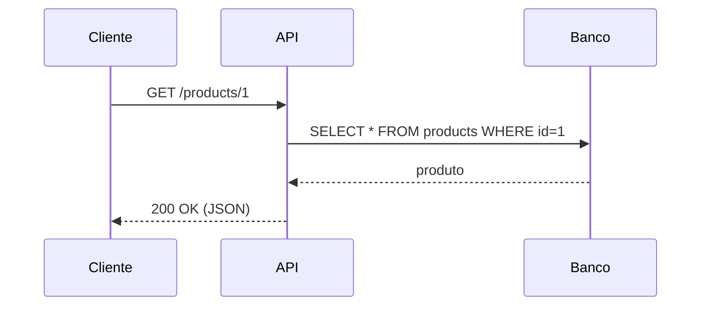

# 🛠️ Ferramentas para APIs e Arquitetura

> **Módulo 04 · Arquiteturas da atualidade** — Ferramentas de apoio para documentar, simular, testar e diagramar sistemas.

---

## 1. Documentação de APIs

### Swagger / OpenAPI

- **OpenAPI** é a *especificação* (YAML/JSON) que descreve uma API REST: endpoints, parâmetros, schemas, respostas e autenticação.
- **Swagger** é o conjunto de ferramentas em torno dela: **Swagger UI** (página interativa para testar a API), **Swagger Editor** e **Swagger Codegen** (gera clientes/servidores).

```yaml
openapi: 3.0.3
info:
  title: API de Produtos
  version: 1.0.0
paths:
  /products/{id}:
    get:
      summary: Busca um produto por ID
      parameters:
        - name: id
          in: path
          required: true
          schema: { type: string }
      responses:
        '200':
          description: Produto encontrado
          content:
            application/json:
              schema: { $ref: '#/components/schemas/Product' }
        '404': { description: Produto não encontrado }
components:
  schemas:
    Product:
      type: object
      properties:
        id: { type: string }
        name: { type: string }
        price: { type: number }
```

Em Node.js/Express: `swagger-ui-express` + `swagger-jsdoc`. Em NestJS: `@nestjs/swagger`.

**Abordagens:**
- **Design-first (contract-first):** escreve o contrato OpenAPI antes do código → front e back trabalham em paralelo.
- **Code-first:** gera a documentação a partir de anotações no código.

## 2. Mock de APIs

### Mockoon

Cria **servidores de API falsos** localmente, sem código: define rotas, respostas, status HTTP e atrasos. Útil para:

- o front-end avançar antes do back-end existir;
- simular falhas (500, timeout) de serviços externos;
- testes de integração sem depender de terceiros.

Importa arquivos OpenAPI e tem CLI (`mockoon-cli`) para rodar em CI/Docker.

**Alternativas:** WireMock, Prism (Stoplight, gera mock a partir do OpenAPI), json-server, MSW (no browser/Node).

## 3. Clientes e testes de API

| Ferramenta | Uso |
|---|---|
| **Postman / Insomnia / Bruno** | Montar e testar requisições, coleções, variáveis de ambiente |
| **Newman** | Rodar coleções do Postman no CI |
| **k6 / JMeter / Gatling** | Testes de carga e desempenho |
| **Pact** | Testes de contrato entre consumidor e provedor |

## 4. GraphQL

- **GraphiQL / Apollo Sandbox:** IDE no navegador para explorar o schema e executar queries.
- **GraphQL Code Generator:** gera tipos TypeScript a partir do schema.

## 5. Diagramação de arquitetura

| Ferramenta | Destaque |
|---|---|
| **Modelo C4** (Contexto, Contêiner, Componente, Código) | Notação para diagramar arquitetura em níveis de zoom |
| **Structurizr** | Diagramas C4 como código |
| **PlantUML / Mermaid** | Diagramas (sequência, classe, C4) em texto, versionáveis no Git |
| **draw.io / Lucidchart / Excalidraw** | Diagramação visual |



## 6. Decisões e documentação

- **ADR** (*Architecture Decision Records*) com `adr-tools` ou Log4brains;
- **Docs-as-code:** documentação em Markdown versionada junto ao código (MkDocs, Docusaurus).

---

## ✅ Pontos-chave

- **OpenAPI** = contrato; **Swagger** = ferramentas sobre o contrato.
- **Mockoon** simula APIs para desacoplar times e testar falhas.
- Diagramas e decisões devem ser **versionados** junto ao código.

## ❓ Perguntas de revisão

<details><summary>1. Qual a diferença entre Swagger e OpenAPI?</summary>
OpenAPI é a especificação do contrato; Swagger é o conjunto de ferramentas (UI, Editor, Codegen) que trabalha com essa especificação.
</details>

<details><summary>2. Qual a vantagem da abordagem design-first?</summary>
O contrato é acordado antes do código, permitindo que front-end e back-end trabalhem em paralelo (com mocks) e reduzindo retrabalho.
</details>

<details><summary>3. Em que situações usar um mock server como o Mockoon?</summary>
Quando a API real ainda não existe, é instável, é paga/limitada, ou para simular erros e latência em testes.
</details>

## 🔗 Relacionadas

- [01 API REST](01%20Api%20Rest.md)
- [02 API GraphQL](02%20Api%20GraphQl.md)

## 📚 Referências

- OpenAPI Initiative — https://www.openapis.org
- Mockoon — https://mockoon.com
- Modelo C4 — https://c4model.com
