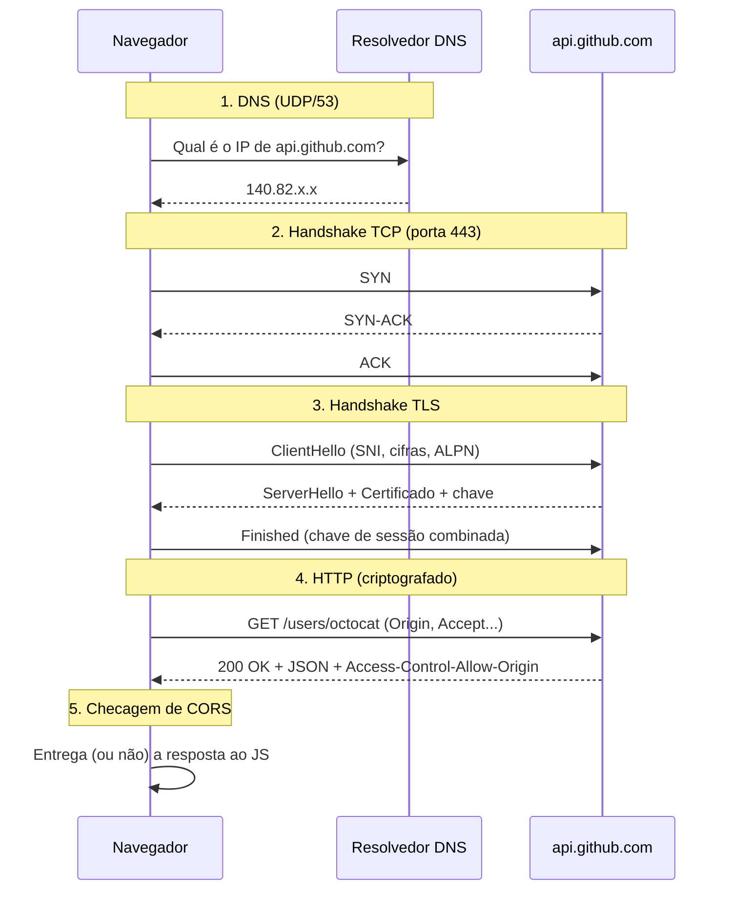

# 🌐 O caminho de uma requisição HTTPS

> O que acontece, camada por camada, entre um `fetch('https://api.github.com/users/octocat')` e o JSON chegando no seu código.

**Trilha 1: Redes** · Referência: *Computer Networking: A Top-Down Approach* (Kurose & Ross)

---

## 📌 Sumário

- [A analogia](#-a-analogia)
- [As camadas](#-as-camadas-tcpip-x-osi)
- [Visão geral do fluxo](#-visão-geral-do-fluxo)
- [Passo a passo](#-passo-a-passo)
- [CORS: quem barra é o navegador](#-cors-quem-barra-é-o-navegador)
- [O custo em latência](#-o-custo-em-latência)
- [No dia a dia (Node, NestJS, Next.js)](#-no-dia-a-dia-node-nestjs-nextjs)
- [Erros comuns de entendimento](#-erros-comuns-de-entendimento)
- [Leituras no Kurose](#-leituras-no-kurose)

---

## 📞 A analogia

Ligar para o banco para tratar de um assunto sigiloso:

| Na ligação | Na rede |
|---|---|
| Procurar o número na lista telefônica | **DNS** |
| "Alô?" / "Alô, tô ouvindo" / "Beleza" | **Handshake TCP** |
| O atendente prova que é do banco e vocês combinam um código secreto | **Handshake TLS** |
| Fazer o pedido | **Requisição HTTP** |
| Receber a resposta | **Resposta HTTP** |

E, como numa encomenda dos Correios, cada etapa coloca **o seu próprio envelope** por cima do anterior. Isso é o **encapsulamento**.

---

## 🧱 As camadas (TCP/IP x OSI)

| TCP/IP (Kurose) | OSI | Unidade | Exemplos | Analogia |
|---|---|---|---|---|
| **Aplicação** | 7, 6, 5 | Mensagem | HTTP, DNS, TLS\* | O bilhete e o embrulho |
| **Transporte** | 4 | Segmento | TCP, UDP | Sedex com AR x carta simples |
| **Rede** | 3 | Datagrama | IP, ICMP | Endereço com CEP |
| **Enlace** | 2 | Quadro | Ethernet, Wi-Fi, ARP | O trecho entre duas agências |
| **Física** | 1 | Bits | Cabo, fibra, rádio | A estrada |

\* O TLS fica entre a aplicação e o TCP. No OSI costuma ser colocado nas camadas 5/6.

```
┌─────────────────────────────────────────────────────────┐
│ Ethernet │ IP │ TCP │ TLS │ HTTP: GET /users/octocat   │
└─────────────────────────────────────────────────────────┘
  enlace    rede  transp.  ←────── aplicação ──────→
```

Na ida, cada camada **adiciona** o seu cabeçalho. Na volta, cada uma **remove** o seu e passa o resto para cima.

---

## 🗺️ Visão geral do fluxo



---

## 🔍 Passo a passo

### 1️⃣ DNS: traduz o nome em IP
**Camada:** aplicação · **Transporte:** normalmente UDP, porta 53

- O site tem um **nome de domínio**. O DNS é a **lista telefônica** que guarda registros como `A` (IPv4) e `AAAA` (IPv6).
- Ordem de busca: **cache do navegador → cache do SO / `/etc/hosts` → resolvedor recursivo** (roteador, provedor, `8.8.8.8`).
- Se o resolvedor não tem a resposta em cache, ele desce a hierarquia: **raiz → TLD `.com` → servidor autoritativo de `github.com`**.
- O IP devolvido pode ser de um **load balancer, CDN ou proxy reverso**, não necessariamente do servidor da aplicação.
- Um domínio pode ter **vários IPs**, e um IP pode servir **vários sites**.

> ⚠️ `192.168.x.x`, `10.x.x.x` e `172.16-31.x.x` são **IPs privados** (rede local). Um site público nunca responde num deles.

### 2️⃣ Handshake TCP: "a linha está boa?"
**Camada:** transporte · **Porta:** 443

```
Cliente ── SYN ──────▶ Servidor
Cliente ◀── SYN-ACK ── Servidor
Cliente ── ACK ──────▶ Servidor
```

- Cria uma conexão **confiável**: números de sequência, confirmação de recebimento e retransmissão.
- Custa **1 RTT** antes de qualquer dado.
- "TCP/IP" é o nome da **pilha inteira**. Esta etapa é o **handshake TCP**.

### 3️⃣ Handshake TLS: o "S" do HTTPS
**Camada:** entre a aplicação e o TCP

1. **ClientHello:** versões e cifras aceitas, **SNI** (`api.github.com`) e **ALPN** (HTTP/2 ou HTTP/1.1).
2. **ServerHello + certificado:** o navegador valida a **cadeia até uma CA confiável** e confere se o certificado vale para aquele domínio.
3. **Troca de chaves (ECDHE):** os dois derivam uma **chave de sessão simétrica** sem que ela trafegue pela rede.

- TLS 1.3 custa **1 RTT**.
- ❗ **Aqui ainda não existe header HTTP.** O TLS só cuida de **identidade** e **criptografia**.

### 4️⃣ Requisição HTTP
**Camada:** aplicação (dentro do túnel TLS)

```http
GET /users/octocat HTTP/2
Host: api.github.com
Accept: application/json
Origin: https://meuapp.com
```

### 5️⃣ Resposta HTTP

```http
HTTP/2 200 OK
Content-Type: application/json; charset=utf-8
Access-Control-Allow-Origin: *

{ "login": "octocat", ... }
```

### 6️⃣ Por baixo de tudo: rede, enlace e física
- Cada segmento TCP vai dentro de um **datagrama IP**.
- Para sair da rede local, a máquina descobre o **MAC do roteador (gateway)** via **ARP**.
- O pacote segue **salto a salto** pelos roteadores. Cada um só olha o IP de destino (o "CEP") e nunca abre o HTTP.

---

## 🚪 CORS: quem barra é o navegador

> **Analogia:** o navegador é o **porteiro do prédio**. A carta (resposta) chega de qualquer jeito. O porteiro só a entrega ao morador (o seu JS) se ela tiver o carimbo do remetente autorizando aquele prédio.

- O navegador envia `Origin` na **requisição**. O servidor responde com `Access-Control-Allow-Origin`.
- Em requisições **simples** (GET sem headers customizados) **não há preflight**: a requisição **chega ao servidor e é processada**. Só a leitura da resposta é bloqueada.
- **Preflight (`OPTIONS`)** acontece com PUT/DELETE/PATCH, `Content-Type: application/json` num POST, ou headers como `Authorization`.
- 🔐 **O CORS não protege o servidor.** `curl`, Postman e backends ignoram o CORS. Ele não substitui **autenticação nem autorização**.

---

## ⏱️ O custo em latência

| Etapa | Custo aproximado |
|---|---|
| DNS (sem cache) | 1 ou mais RTTs até o resolvedor |
| Handshake TCP | 1 RTT |
| Handshake TLS 1.3 | 1 RTT |
| Requisição + resposta HTTP | 1 RTT + tempo de processamento |

➡️ Numa conexão **nova**, são cerca de **3 a 4 RTTs** até o primeiro byte do JSON. Por isso o **reaproveitamento de conexões** importa tanto.

---

## 💻 No dia a dia (Node, NestJS, Next.js)

| Conceito | Onde aparece |
|---|---|
| Camada de aplicação | `http`/`https`, Express, NestJS, `fetch` |
| TCP cru | módulo `net` |
| UDP | módulo `dgram` |
| Porta (transporte) | `app.listen(3000)` |
| Reuso de conexão | `fetch` do Node (undici) usa pool e keep-alive |
| Adiantar DNS + TCP + TLS | `<link rel="preconnect" href="https://api.github.com">` no Next.js |
| CORS no backend | `app.enableCors({ origin: [...] })` no NestJS |

**Lendo os erros pela camada:**

| Erro | O que significa | Camada |
|---|---|---|
| `ENOTFOUND` | O DNS não resolveu o nome | Aplicação (DNS) |
| `ECONNREFUSED` | Chegou no IP, mas nada escuta na porta | Transporte |
| `ETIMEDOUT` | Sem resposta: firewall, rota ou servidor fora do ar | Rede / transporte |
| `CERT_HAS_EXPIRED`, `UNABLE_TO_VERIFY_LEAF_SIGNATURE` | Falha na validação do certificado | TLS |
| Erro de CORS no console | O navegador barrou a leitura da resposta | Navegador (política) |

---

## 🧠 Erros comuns de entendimento

| ❌ Ideia errada | ✅ O certo |
|---|---|
| "Cada site possui um DNS" | O site tem um **domínio**. O DNS é o **sistema** que traduz o domínio em IP |
| "O DNS é tipo 192.168..." | Isso é um **IP**, e ainda por cima **privado** |
| "O IP é onde meu site roda" | Muitas vezes é o IP de um **load balancer, CDN ou proxy** |
| "Estabelece uma conexão TCP/IP" | Estabelece um **handshake TCP**. TCP/IP é a pilha toda |
| "No HTTPS são criados os headers" | O TLS faz **certificado + chaves**. Os headers são do **HTTP**, que vem depois |
| "O servidor verifica o CORS" | Quem aplica o CORS é o **navegador**. O servidor só envia os headers |

---

## 📚 Leituras no Kurose

| Seção | Tema |
|---|---|
| **1.5** | Camadas de protocolo e encapsulamento |
| **2.2** | HTTP (conexões persistentes x não persistentes) |
| **2.4** | DNS (hierarquia, cache, registros) |
| **3.5** | TCP (handshake em 3.5.6) |
| **4.3** | IP e endereçamento (IPs privados, sub-redes) |
| **8.6** | TLS |

**Complementos do roteiro:** [Modelo OSI, Cloudflare](https://www.cloudflare.com/learning/ddos/glossary/open-systems-interconnection-model-osi/) · [O que é DNS, Cloudflare](https://www.cloudflare.com/learning/dns/what-is-dns) · [HTTP, MDN](https://developer.mozilla.org/en-US/docs/Web/HTTP)

---

## 🔬 Próximo passo: ver isso no Wireshark

Filtros úteis para a atividade prática:

```
dns                          # consulta e resposta do DNS
tcp.flags.syn == 1           # handshake TCP
tls.handshake                # ClientHello, ServerHello, certificado
tls.handshake.type == 1      # só o ClientHello (dá para ver o SNI)
```
